# ITMS — IT Management System

<p align="center">
  <a href="https://itms.ai-automation-hub.tech"></a>
  
  
  
  
</p>

> **One system for ITAM + ITSM + CMDB** — track assets, resolve tickets, and map blast radius. Liquid Glass UI in light & dark. 👇 Watch it move:
>
> 1. **ITAM** — hardware inventory, JSONB specs, user assignments, lifecycle tracking
> 2. **ITSM** — incidents, service requests, priority matrices, requester→asset linkages
> 3. **CMDB** — CI dependency mapping with recursive downstream impact analysis

<p align="center">
  <a href="https://itms.ai-automation-hub.tech">
    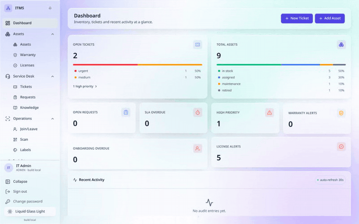
  </a>
  <br><em>Live demo (seeded data, password <code>demo1234</code>) — <a href="https://itms.ai-automation-hub.tech">itms.ai-automation-hub.tech →</a></em>
</p>

## ✨ Liquid Glass — light & dark

<p align="center">
  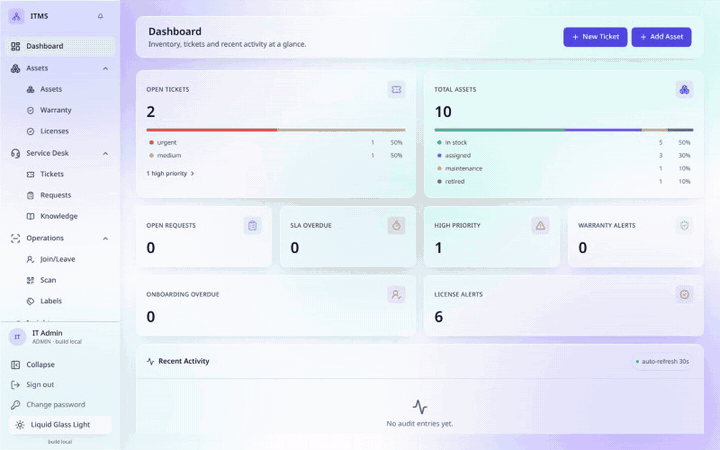
  <br><em>One click: Liquid Glass Light → Dark. System-auto mode follows your device.</em>
</p>

| ☀︎ Liquid Glass Light | ☾ Liquid Glass Dark |
|---|---|
| 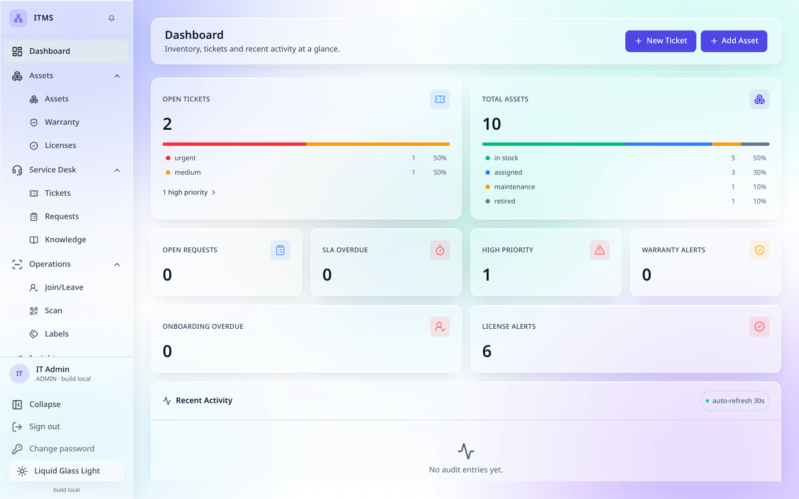 | 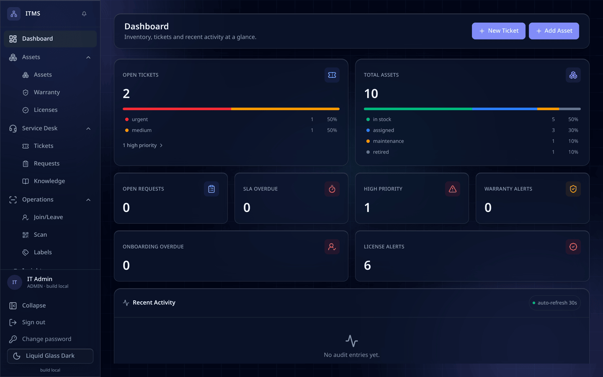 |
| 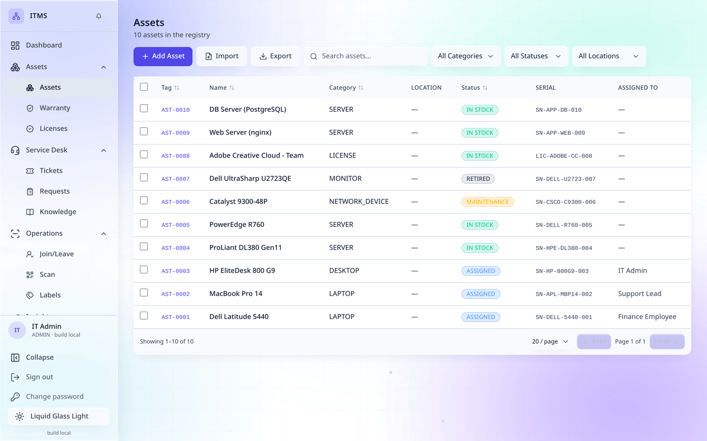 | 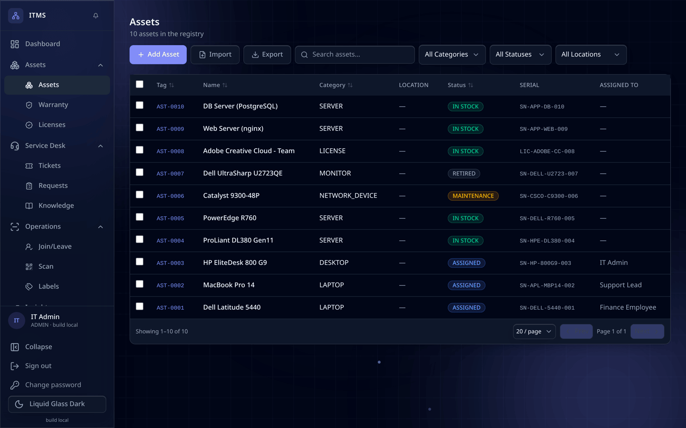 |
| 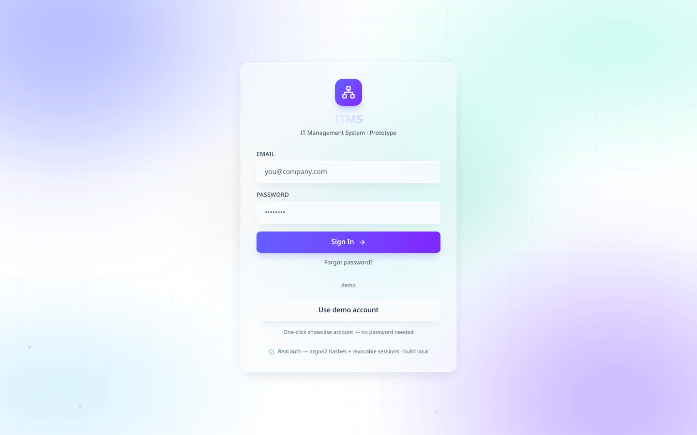 | 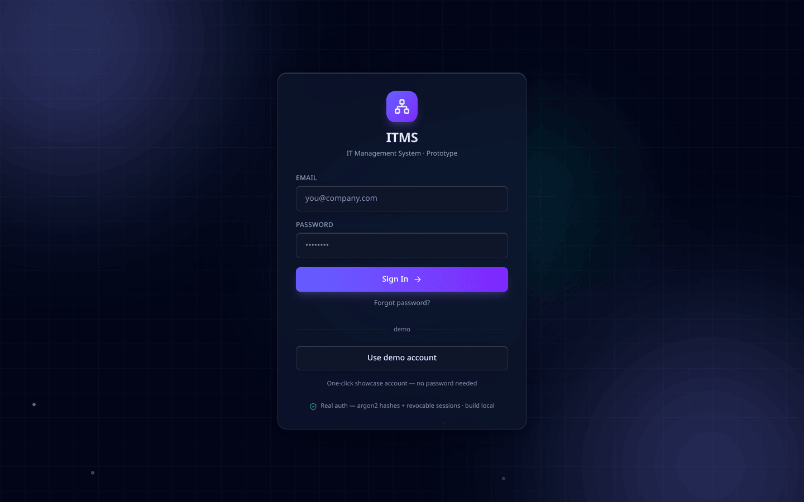 |

<details>
<summary>🎬 More clips (tickets · CMDB impact · mobile)</summary>
<br>

| Flow | Preview |
|---|---|
| 🎫 Tickets (dark) — list → drawer → Advance status | 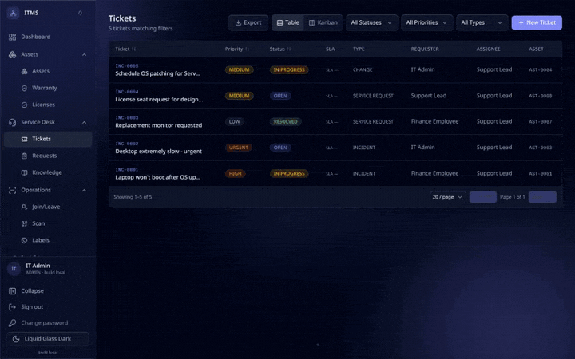 |
| 🕸 CMDB blast radius (light) — click switch → 2 impacted | 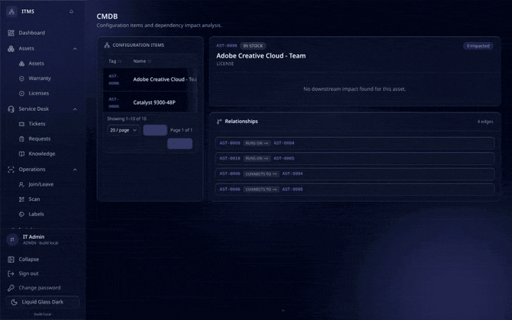 |
| 📱 Mobile bottom-nav (375px) | 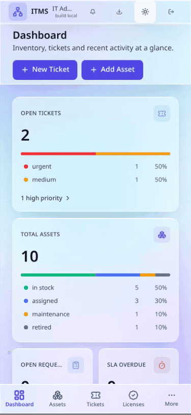 |

Full-quality MP4s (no GIF dither): [`docs/demo/`](./docs/demo/) — `hero-dashboard.mp4`, `theme-switch.mp4`, `tickets-flow.mp4`, `cmdb-impact.mp4`, `mobile-nav.mp4`.

</details>

📸 Full gallery with MP4s: [`docs/DEMO.md`](./docs/DEMO.md).

---

## Stack

| Layer | Tech |
|---|---|
| Backend | Rust 1.85+ · axum 0.8 · sqlx 0.9 (runtime queries, embedded migrations) |
| Database | PostgreSQL 18 (`postgres:18-alpine`) · jsonb specs |
| Frontend | React 19 · Vite · TypeScript · Tailwind CSS v4 · TanStack Query · react-router 7 |
| Routing/TLS | Traefik v3.6 (shared VPS ingress, Let's Encrypt) |
| Deploy | Docker Compose on `itms-net` + `dokploy-network` |

## Layout

```
backend/    Rust API server (server bin) + seed bin
frontend/   React SPA (Vite build → nginx, /api proxied to backend)
docs/       PLAN.md (build & deploy plan), screenshots/
docker-compose.yml   db + backend + frontend, Traefik labels for itms.ai-automation-hub.tech
```

## Local run

```bash
cp .env.example .env   # set POSTGRES_PASSWORD
docker compose up -d --build
docker compose exec backend /usr/local/bin/seed   # demo data
```

## API surface

- `GET /api/v1/dashboard/metrics`
- `GET|POST /api/v1/assets` · `PATCH /api/v1/assets/:id/assign`
- `GET|POST /api/v1/tickets` · `PATCH /api/v1/tickets/:id/status`
- `GET /api/v1/cmdb/topology` · `GET /api/v1/cmdb/impact/:asset_id`
- `GET /api/v1/audit/log`

## Project management

Issues and milestones live here on GitHub. Live demo: https://itms.ai-automation-hub.tech (seeded demo data, demo logins use credentials that are provisioned out-of-band and rotated).

## License

MIT — see [LICENSE](LICENSE).
